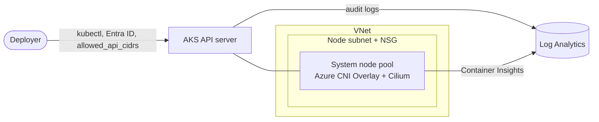

# Azure Managed Kubernetes (AKS)

An AKS cluster with Entra ID integration and a system node pool.

OpenTofu demo template. Standalone, no dependency on other repos. Compatible with Terraform.

## Architecture



- Resource group
- VNet with a node subnet and an NSG
- AKS cluster (Free tier) with one system node pool, Azure CNI Overlay with Cilium
- Log Analytics workspace for Container Insights and audit logs
- Role assignment that makes the deploying identity cluster admin

No sample workload is deployed.

## Security

- Entra ID integration with Azure RBAC, local accounts disabled
- API server limited to `allowed_api_cidrs` (required, `0.0.0.0/0` is rejected)
- OIDC issuer and workload identity enabled
- Azure Policy add-on enabled
- Nodes without public IPs, Cilium network policies available
- Container Insights and audit logs (`kube-audit-admin`, `guard`) to Log Analytics
- Automatic patch upgrades for Kubernetes and node images, Key Vault secrets provider with rotation

The node subnet NSG has only the default rules. If you expose a `LoadBalancer` service to the internet, add an inbound rule for it.

Accepted checkov findings (documented inline in the code):

| Check | Reason |
|---|---|
| CKV_AZURE_6, CKV_AZURE_115 | Public API server limited to `allowed_api_cidrs`, a private cluster would need a jump host |
| CKV_AZURE_117 | Platform-managed disk keys, a disk encryption set is out of scope |
| CKV_AZURE_170 | Free tier, the paid SLA tier is not needed for a demo |
| CKV_AZURE_226 | Ephemeral OS disks need VM sizes with a local cache disk |
| CKV_AZURE_227 | Host encryption is configurable (`advanced_settings.host_encryption_enabled`) |
| CKV_AZURE_232 | Single system node pool, workloads run on it too |

## Usage

Sign in with `az login` and set `ARM_SUBSCRIPTION_ID` to the target subscription.

```bash
cp terraform.tfvars.example terraform.tfvars
tofu init
tofu plan
tofu apply
```

## Access

The identity that runs OpenTofu gets the role "Azure Kubernetes Service RBAC Cluster Admin". From an IP in `allowed_api_cidrs`, with `kubelogin` installed:

```bash
az aks get-credentials --resource-group <resource_group_name> --name <cluster_name>
kubelogin convert-kubeconfig -l azurecli
kubectl get nodes
```

To give other people access, assign them an AKS RBAC role on the cluster.


## Inputs

| Name | Description | Default |
|---|---|---|
| `name_prefix` | Prefix for all resource names | `"demo"` |
| `location` | Azure location | `"germanywestcentral"` |
| `allowed_api_cidrs` | CIDRs allowed to reach the API server (required, `/0` rejected) | none |
| `advanced_settings` | Object with the settings below, all optional | `{}` |

`advanced_settings` attributes (shown as "Advanced Settings" in the StackGuardian form):

| Name | Description | Default |
|---|---|---|
| `vnet_cidr` | Address space of the VNet (pods use `192.168.0.0/16`, services `172.16.0.0/16`) | `"10.0.0.0/16"` |
| `kubernetes_version` | Kubernetes minor version, AKS picks the latest patch | `"1.37"` |
| `node_vm_size` | VM size of the system node pool | `"Standard_D2s_v5"` |
| `node_count` | Number of nodes | `2` |
| `host_encryption_enabled` | Encryption at host (needs the subscription feature) | `false` |
| `log_retention_days` | Log retention in Log Analytics | `90` |
| `tags` | Additional tags for all resources | `{}` |

## Outputs

| Name | Description |
|---|---|
| `cluster_name` | Name of the AKS cluster |
| `resource_group_name` | Name of the resource group |
| `cluster_fqdn` | FQDN of the API server |
| `kubernetes_version` | Running Kubernetes version |
| `oidc_issuer_url` | OIDC issuer URL for workload identity |
| `node_pool_name` | Name of the system node pool |
| `kubeconfig_command` | Commands to add the cluster to your kubeconfig |

## Cost

The node VMs, the standard load balancer and Log Analytics ingestion are billed, also when idle. The Free tier has no control plane fee. Creating the cluster takes about 10 minutes.

**Destroy after the demo:**

```bash
tofu destroy
```

## Tests

The GitLab pipeline (`.gitlab-ci.yml`) lints every push. Merge requests into `development` or `main` also run
validation, the checkov scan and the unit tests. A tag runs all of these plus the integration tests, which deploy
real resources and destroy them again, and then creates a release. Integration tests run only when the CI/CD variables `AZURE_CLIENT_ID`, `AZURE_TENANT_ID` and `AZURE_SUBSCRIPTION_ID` are set: an app registration with a federated credential for GitLab OIDC and the audience `api://AzureADTokenExchange`.

The GitHub Actions workflow (`.github/workflows/ci.yml`) runs the same jobs: every push, pull requests into `development` or `main`, and tags. Set the three `AZURE_*` values as repository variables; the app registration then needs a federated credential for GitHub.

```bash
tofu test -test-directory=tests/unit
```

Test cases: [tests/README.md](tests/README.md)

## Development

```bash
pre-commit install
pre-commit run --all-files
```
